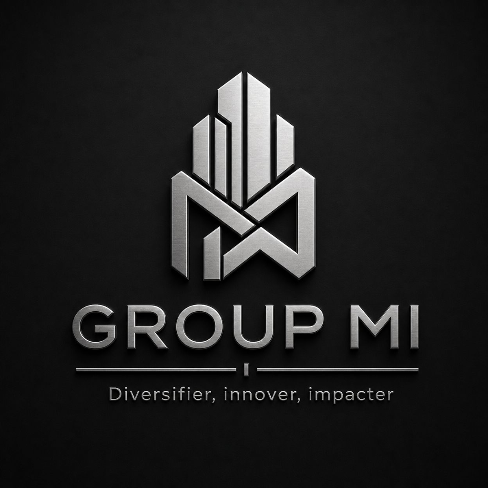

# SIGMI - Système d'Information GROUP MI

<div align="center">



**CRM Multi-Pôles Professionnel pour GROUP MI**

[](https://nextjs.org/)
[](https://www.typescriptlang.org/)
[](https://tailwindcss.com/)
[](https://supabase.com/)

[](./MVP_CHECKLIST.md)
[]()

</div>

---

## 📖 Description

SIGMI est un **Système d'Information Gestion Multi-pôles Intégré** développé pour GROUP MI. C'est une application CRM moderne et professionnelle qui centralise la gestion des clients, opportunités, projets, collaborateurs, contacts, documents, tâches et interactions pour les 6 pôles business de l'entreprise.

### 🎯 Mission

> Centraliser et structurer les informations dispersées de GROUP MI dans une interface intuitive, professionnelle et sécurisée.

### 🏢 Les 6 Pôles Business

1. **Ingénierie Informatique** - Solutions technologiques et logicielles
2. **Génie Civil et BTP** - Construction et infrastructures
3. **Agrobusiness** - Agriculture et agroalimentaire
4. **Trading International** - Commerce international
5. **Transition Énergétique** - Énergies renouvelables
6. **Centre d'Incubation et d'Impulsion des Entreprises** - Accompagnement entrepreneurial

---

## ✨ Fonctionnalités

### 🏠 Page d'accueil
- Design premium avec animations Framer Motion
- Section héro avec call-to-action
- Statistiques globales animées
- Présentation des 6 pôles business
- Responsive design

### 👤 Authentification & Gestion des Utilisateurs
- Inscription avec sélection de pôle
- Connexion sécurisée via Supabase Auth
- Rôles : Direction, Administrateur Système, Responsable de Pôle, Commercial, Gestionnaire de Projet
- Redirection automatique vers le dashboard du pôle assigné
- Profil collaborateur dans la base de données

### 📊 Dashboard Global
- Vue d'ensemble des KPIs (opportunités, pipeline, projets, collaborateurs)
- Pipeline commercial avec étapes visuelles
- Tâches urgentes
- Activité récente
- Performance par pôle (cliquable pour les administrateurs)

### 🏢 Dashboard par Pôle
- KPIs spécifiques au pôle
- Opportunités, projets et valeur du pôle
- Taux de conversion
- Protection d'accès par pôle

### 📋 Gestion Clients
- Liste avec filtres (recherche, pôle)
- Création, modification, suppression
- Fiche détaillée 360°
- Historique des interactions
- Statistiques par client

### 💼 Gestion Opportunités
- Pipeline commercial (Nouveau → Qualifié → Proposition → Négociation → Gagné/Perdu)
- Vue Kanban du pipeline
- Gestion de la valeur et probabilité
- Association avec clients et pôles
- Fiche détaillée 360°

### 🏗️ Gestion Projets
- Liste avec filtres (recherche, pôle, statut)
- Suivi du budget et de l'avancement
- Association avec opportunités
- Fiche détaillée 360°

### 👥 Gestion Collaborateurs
- Liste avec filtres (recherche, pôle, rôle)
- Gestion des rôles et permissions
- Assignation aux pôles
- Statistiques des collaborateurs

### 📞 Gestion Contacts
- Liste avec filtres (recherche)
- Association avec clients
- Gestion des informations de contact
- Fiche détaillée 360°

### 📄 Gestion Documents
- Liste avec filtres (recherche, type, statut)
- Upload via Supabase Storage
- Téléchargement de fichiers
- Association avec entités
- Fiche détaillée 360°

### ✅ Gestion Tâches
- Liste avec filtres (recherche, pôle, statut, priorité)
- Indicateur de tâches en retard
- Assignation aux collaborateurs
- Association avec projets/entités
- Fiche détaillée 360°

### 💬 Gestion Interactions
- Types : Email, Appel, Réunion, Visite, Autre
- Association avec clients/opportunités/projets
- Suivi des résultats et notes
- Fiche détaillée 360°

### 🔒 Permissions & Sécurité
- Filtrage automatique par pôle pour les membres
- Filtres UI masqués pour les non-administrateurs
- Protection des dashboards par pôle
- Détection des administrateurs
- RLS Supabase (à finaliser pour sécurité maximale)

---

## 🎨 Design & UX

- **Identité visuelle GROUP MI** : Bleu professionnel (#1D4ED8) et Or élégant (#D4AF37)
- **Animations** : Framer Motion pour des transitions fluides
- **Glassmorphism** : Effets de transparence et flou modernes
- **Cartes rotatives** : Design premium avec halos lumineux
- **Responsive** : Optimisé pour mobile, tablette et desktop
- **Accessibilité** : Contrastes élevés, navigation clavier

---

## 🛠️ Stack Technique

### Frontend
- **Framework** : Next.js 16.3.6 (App Router)
- **Langage** : TypeScript 5.0
- **Styling** : Tailwind CSS 3.4
- **Animations** : Framer Motion
- **UI Components** : shadcn/ui
- **Forms** : React Hook Form + Zod
- **State Management** : React Context + Custom Hooks
- **Icons** : Lucide React

### Backend
- **BaaS** : Supabase (PostgreSQL, Auth, Storage)
- **Database** : PostgreSQL managé
- **Authentication** : Supabase Auth
- **File Storage** : Supabase Storage
- **API** : Supabase PostgREST

### Infrastructure
- **Hosting** : Vercel (recommandé)
- **Database** : Supabase Cloud
- **CI/CD** : GitHub Actions (optionnel)

---

## 📦 Installation

### Prérequis

- Node.js 18+ 
- npm ou yarn
- Un compte Supabase

### Étapes d'installation

1. **Cloner le repository**
```bash
git clone https://github.com/yafisco/SIGMI.git
cd SIGMI
```

2. **Installer les dépendances**
```bash
npm install
```

3. **Configurer les variables d'environnement**

Créer un fichier `.env.local` à la racine du projet :

```env
NEXT_PUBLIC_SUPABASE_URL=votre_url_supabase
NEXT_PUBLIC_SUPABASE_ANON_KEY=votre_cle_anon_supabase
```

4. **Configurer Supabase**

Suivez les guides dans le dossier documentation :
- [SETUP_DATABASE.md](./SETUP_DATABASE.md) - Configuration de la base de données
- [SETUP_STORAGE.md](./SETUP_STORAGE.md) - Configuration du stockage
- [SETUP_EMAIL_CONFIRMATION.md](./SETUP_EMAIL_CONFIRMATION.md) - Configuration des emails

5. **Lancer le serveur de développement**
```bash
npm run dev
```

L'application sera disponible sur [http://localhost:3000](http://localhost:3000)

---

## 📚 Documentation

- [MVP_CHECKLIST.md](./MVP_CHECKLIST.md) - Checklist du MVP et progression
- [CREATE_TEST_USER.md](./CREATE_TEST_USER.md) - Création d'un utilisateur de test
- [DATABASE_SETUP_INSTRUCTIONS.md](./DATABASE_SETUP_INSTRUCTIONS.md) - Instructions détaillées pour la base de données
- [PLAN_DE_TESTS.md](./PLAN_DE_TESTS.md) - Plan de tests

---

## 🚀 Déploiement

### Vercel (Recommandé)

1. Pusher le code sur GitHub
2. Connecter votre compte Vercel
3. Importer le repository depuis GitHub
4. Configurer les variables d'environnement dans Vercel
5. Déployer

### Autres plateformes

Le projet peut être déployé sur n'importe quelle plateforme supportant Next.js :
- Netlify
- Railway
- Render
- AWS Amplify

---

## 📊 Progression du MVP

**Progression globale : 90%**

| Module | Progression | Status |
|--------|------------|--------|
| Authentification | 100% | ✅ Terminé |
| Page d'accueil | 100% | ✅ Terminé |
| Clients | 100% | ✅ Terminé |
| Opportunités | 100% | ✅ Terminé |
| Projets | 100% | ✅ Terminé |
| Collaborateurs | 100% | ✅ Terminé |
| Contacts | 100% | ✅ Terminé |
| Documents | 100% | ✅ Terminé |
| Tâches | 100% | ✅ Terminé |
| Interactions | 100% | ✅ Terminé |
| Pôles Business | 100% | ✅ Terminé |
| Permissions | 80% | ⏳ En cours |
| Design & UX | 100% | ✅ Terminé |
| Infrastructure | 100% | ✅ Terminé |

**Pour atteindre 100% du MVP** :
- RLS Supabase (sécurité serveur)

---

## 🔮 Roadmap Post-MVP

### Fonctionnalités futures

- [ ] Pipeline Kanban Interactif (drag-and-drop)
- [ ] Recherche Globale (multi-entités)
- [ ] Export CSV des données
- [ ] Dashboard Avancé (graphiques, tendances)
- [ ] Notifications In-App
- [ ] Tests Automatisés
- [ ] Sécurité Avancée (2FA, logs d'audit)
- [ ] Application Mobile (React Native)

---

## 👥 Contributeurs

Développé pour **GROUP MI** par l'équipe technique.

---

## 📄 Licence

**Propriétaire** - Tous droits réservés GROUP MI

---

## 📞 Support

Pour toute question ou problème, contactez l'équipe technique de GROUP MI.

---

<div align="center">

**Développé avec ❤️ pour GROUP MI**

[⬆ Retour en haut](#sigmi---système-dinformation-group-mi)

</div>
